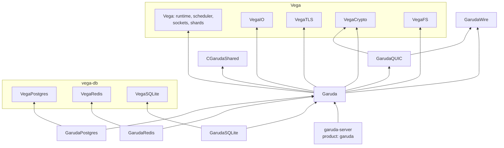
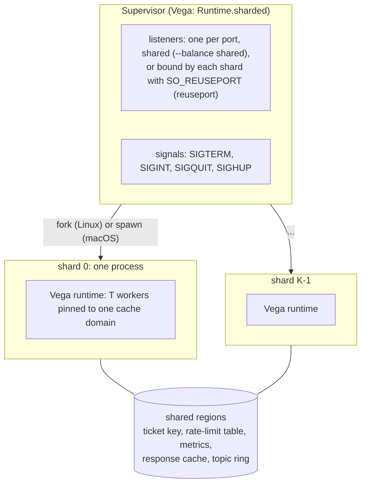
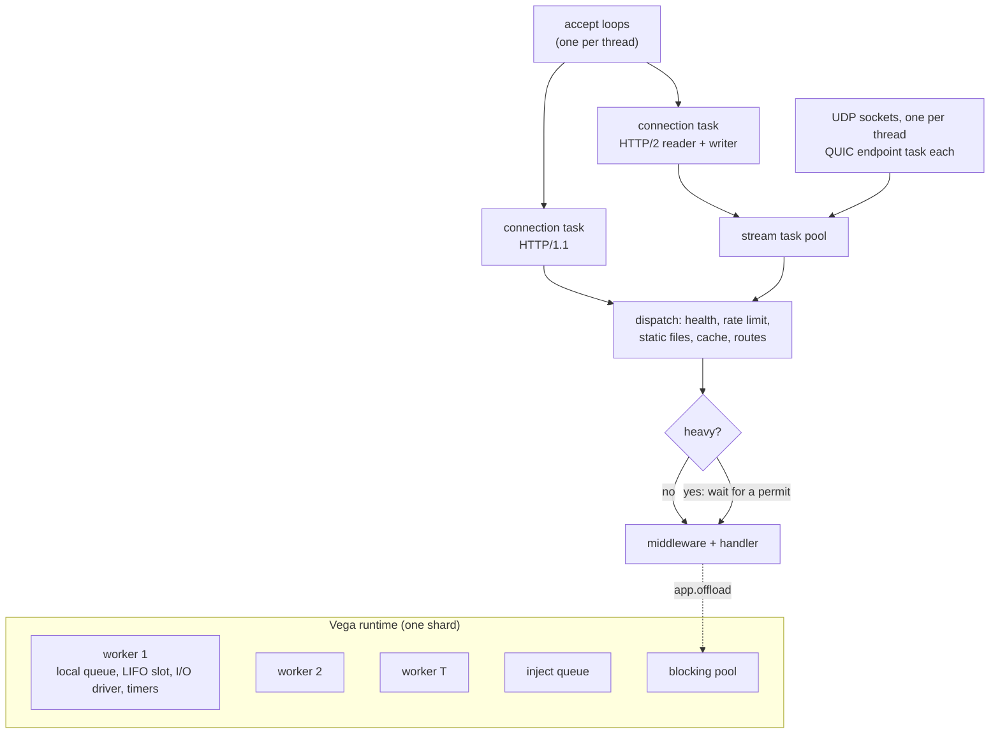

# Architecture

Garuda is one Swift executable: the `Garuda` library plus the routes an
application registers. It runs on [Vega](https://github.com/grepjava/vega), a
Tokio-style work-stealing runtime for Swift. A supervisor process starts
**shards**; each shard is a process with its own Vega runtime, a handful of
worker threads pinned to one cache domain's CPUs. Inside a shard every
connection is a task, and tasks are stolen between threads at any `await`.
Garuda parses HTTP/1.1, HTTP/2 and HTTP/3 itself, the last on its own QUIC
implementation. Foundation is not linked.

Protocol details are in [TRANSPORT.md](TRANSPORT.md), flags in
[CONFIG.md](CONFIG.md), the handler API in [HANDLER-API.md](HANDLER-API.md),
running in production in [DEPLOYMENT.md](DEPLOYMENT.md).

---

## Source tree

The runtime, sockets, TLS, cryptography and file I/O come from Vega; the
database drivers from [vega-db](https://github.com/grepjava/vega-db). Both are
separate packages Garuda depends on by version. Everything below lives in this
repository.

| Target | What it holds |
| --- | --- |
| `GarudaWire` | HTTP on the wire as byte-level state machines: the HTTP/1.1 parser, chunked decoding, HPACK, QPACK, HTTP/2 and HTTP/3 frames, WebSocket frames and permessage-deflate, content-coding negotiation, forwarded-header trust, the response-cache policy. No sockets, no allocation on the hot path. Vendored from aviancore's `AvianHTTP` |
| `GarudaQUIC` | QUIC as a sans-I/O state machine: packets, packet protection, loss recovery and congestion control, streams, path validation, and the server side of the TLS 1.3 handshake QUIC carries. Datagrams in, datagrams out, no clock. Its cryptography is Vega's `VegaCrypto` |
| `CGarudaShared` | C over shared memory, for what the shards share: the response cache table (`garuda_cache.c`) and the topic bus (`garuda_bus.c`) |
| `Garuda` | The server (shards, connections, HTTP/1.1, HTTP/2 and HTTP/3 serving, TLS), dispatch, routes, middleware, extractors, the heavy lane, streaming, WebSocket and WebTransport, the HTTP client, sessions, JWT, the CLI |
| `GarudaTesting` | `app.test`: requests through the real HTTP/1 connection over an in-memory stream |
| `GarudaJSON`, `GarudaMacros` | `@JSON` and `@PostgresRow`, the only code that needs swift-syntax |
| `GarudaPostgres`, `GarudaRedis`, `GarudaSQLite`, `GarudaSQL` | vega-db's drivers re-exported, joined to Garuda's `UUID`, `Timestamp`, JSON and stores |
| `garuda-server` | The `garuda` executable: the benchmark routes, served through the handler API |
| `garuda-conformance` | Routes that make engine behaviour observable to the end-to-end suites |

TLS sessions, keys and the cryptographic primitives are Vega's, over BoringSSL
by default or the system's OpenSSL 3 (a package trait). Swift in Garuda never
imports a TLS library header.

---

## Shards

`app.run()` parses the command line, checks the routes (`app.problems()`),
loads the certificates once to fail early, compiles the application, and hands
the process to Vega's `Runtime.sharded` (`Run.swift`). The process becomes the
**supervisor**. Before starting any shard it:

- binds the listeners: the main port, the `--redirect-http` port and the
  `--metrics-port`. Under `--balance shared` it binds one socket per port and
  every shard accepts on it; under `reuseport` each shard binds its own
  `SO_REUSEPORT` socket;
- maps the **shared regions** (below), laid out from the configuration so the
  supervisor and every shard agree which is which (`SharedMemory.swift`).

Then it starts K shards. On Linux a shard is forked from the supervisor. On
macOS, where system libraries do not survive a fork without exec, it is a
`posix_spawn` of the same executable with the same arguments: the shard runs
`main` again, up to `app.run()`, and Vega tells it from its environment which
shard it is. That is why the routes must come out the same on every run.

The supervisor is one thread and serves nothing. It restarts a shard that
crashes (at once, then backing off from 100 ms to 5 s while it keeps crashing
within a second of starting), passes `SIGTERM` on as `SIGTERM` and `SIGINT` or
`SIGQUIT` as `SIGINT`, kills shards still alive after the grace period, and
on `SIGHUP` restarts the shards one at a time.

**K and T.** By default K is one shard per last-level cache domain (an L3, from
sysfs), and T is the number of CPUs in that domain, each worker pinned to one
of them. `--shards 0` runs everything in the process that was started, with
no supervisor and unpinned threads: the default on macOS and the only mode on
Windows.

### Why processes and threads

Garuda 1 ran one thread per process and balanced by moving connections between
processes. Garuda 2 keeps the process boundary and puts work stealing inside
it:

- **A trap ends a process.** A force-unwrapped `nil`, an index out of range,
  integer overflow or a failed `precondition` stops a Swift process at once:
  nothing unwinds and nothing can catch it. Tokio contains a Rust panic to its
  task; Swift has no equivalent. With K shards a trap takes down 1/K of the
  connections, and the supervisor starts the shard again.
- **Work stealing balances what processes cannot.** Inside a shard an idle
  thread takes ready tasks from a busy one at any `await`, so TLS
  connections, HTTP/2 streams and requests in flight all rebalance. Garuda 1
  could move only idle HTTP/1 connections.
- **A shard per cache domain** keeps a connection's memory in one cache and
  the cross-thread traffic that stealing costs inside it.

### Shared regions

What has to be the server's rather than one shard's lives in memory the
supervisor maps before the first shard starts, the same bytes in every shard
and kept across shard restarts (Vega's `ShardOptions.sharedRegions`). Only
atomics and offsets live there, never pointers, since each process maps it at
its own address. No lock is ever held across processes: a shard that crashed
holding one would hold it for ever.

| region | when | what |
|---|---|---|
| TLS ticket key | `--tls-cert` | drawn by the first shard to start; every shard seals and opens session tickets with it, so a client resumes whichever shard it reaches (`TLS.swift`) |
| rate-limit table | `--rate-limit` | 65,536 entries of a client hash and its GCRA arrival time, updated by compare-and-swap, keyed with a per-server random seed (`RateLimit.swift`) |
| metrics | `--metrics-port` | a row of counters per worker thread per shard, each written by its thread alone; a scrape sums them all (`Metrics.swift`) |
| response cache | `--cache-size` | size-classed slots, each guarded by a version word used as a sequence lock; a writer claims a slot with its process ID, and a slot whose claimant died is taken over (`garuda_cache.c`) |
| topic ring | `--broadcast-size` | messages a `Topic` publishes, with rising numbers for `Last-Event-ID` (`garuda_bus.c`) |

The **topic ring** has one writer at a time, claimed by compare-and-swap with
the writer's process ID. Each shard has one thread that sleeps on a wake word
in the region -- a futex on Linux, `os_sync` on Darwin -- reads what was
published, and hands it to the subscribers that shard holds. A burst costs one
wake per shard, not one per message. Readers take no claim: a reader copies a
message out and checks the writer has not since reached around the ring to it.

Everything else is per shard: connections, buffers, `app.state` (database
pools, clients, caches), in-memory session and token stores, and timers.

---

## Inside a shard

### The runtime

Vega's scheduler follows Tokio's multi-threaded one. Each worker thread has a
local queue of ready tasks and a LIFO slot for the task it just woke, so a
request handed from one task to another runs next on the same thread, with
its data still in cache. A worker with nothing to do steals half the queue of
a random busy one, or takes from the shared inject queue, and when there is
nothing anywhere it spins briefly and then sleeps in its own I/O driver until
an event or its next timer. Every Vega primitive spends from a per-task budget
and yields when it runs out, since Swift cannot preempt a task.

Each worker has its own I/O driver: an io_uring ring on Linux 6.7 and later
(submitted on the local ring, completed there, resumed on any thread), epoll
elsewhere on Linux, kqueue on macOS. `--io` chooses. Each also has its own
timer wheel.

The package is built with `NonisolatedNonsendingByDefault`, as Vega is: an
async function runs on its caller's executor, so a call into a handler and
back is no hop.

### Connections

A shard runs one accept loop per thread (`--acceptors`), so a new connection
usually starts on the thread that accepted it. Vega sets `TCP_NODELAY` on
every accepted socket.

**Every connection is a task.** An HTTP/1.1 connection's task owns its read
buffer and its **exchange** -- the request's offsets, the response's status,
headers and body -- and runs a loop: parse a head from the bytes in hand,
read more only when there is no whole head, take the body, dispatch, write
the answer into the output buffer. Pipelined requests are answered in a
batch, flushed when the task is about to wait for input. Every wait on the
client is bounded by a timeout. The parts of a connection -- read buffer,
output buffer, exchange -- are kept when it ends, in a list per worker thread,
and the next connection on that thread takes them, so short connections cost
no allocation and no fight over malloc's arenas (`ConnectionCache.swift`).

Over TLS the accepted socket is handed to Vega's `TLSStream` for the
handshake, bounded by `tlsHandshakeTimeout`, and is then served as plain text
is. SNI picks the certificate from a store every handshake consults, which
`--tls-reload` replaces without touching open connections.

**HTTP/2** (`HTTP2.swift`, `HTTP2Writer.swift`). A connection becomes HTTP/2
when ALPN chose `h2`, or when a cleartext client opens with the preface,
looked for in the HTTP/1 read buffer. The connection's task becomes its
**reader**: it reads frames, owns the HPACK decoder and the stream table, and
enforces every limit. A second task, the **writer**, writes control frames and
answers that could not be written by their own stream. A stream's request is
decoded into its own exchange, described exactly as an HTTP/1.1 head would be,
so routing and middleware see a request like any other. Its body is collected
whole (or, for an `onStreamingBody` route, handed to the handler through a
pipe as DATA arrives), then the stream runs in a task from the shard's
**stream pool**, so a handler that waits holds up no other stream. A stream whose answer is ready
writes it itself when nobody else is writing and the windows take it whole.

**HTTP/3** (`HTTP3.swift`, `HTTP3Connection.swift`). Each shard binds one UDP
socket per thread with `SO_REUSEPORT`, so the kernel spreads clients across
them. Each socket has one **endpoint** task that owns everything QUIC for it:
the connection-ID table, every `QUICConnection` (from `GarudaQUIC`, which does
no I/O of its own) and the HTTP/3 state on top. Nothing there is locked. Its
loop receives a batch of datagrams, waiting no longer than the earliest QUIC
timer; feeds each to its connection; runs due timers; takes the answers
request tasks posted; and sends what every connection has to say, coalesced
with UDP GSO where the kernel allows. Requests run in the shard's stream pool,
as HTTP/2 streams do. QPACK runs with a dynamic table of capacity zero, so no
header block ever waits on another stream.

**Inline answers.** A route that has run many times without ever suspending,
and is not heavy, is answered where its request arrived: by the HTTP/2 reader
when it is the connection's only stream, by the QUIC endpoint once the
datagrams in hand are handled. That saves the hand-off to a pooled task,
which costs more than such a route does. One run that suspends sends the
route to the pool for good.

**Cancellation.** An HTTP/2 `RST_STREAM`, or an HTTP/3 reset, cancels the
stream's task -- Swift task cancellation, so a handler waiting on I/O or a
sleep stops waiting. Pooled tasks are reused, and cancellation cannot be
undone, so a cancelled task finishes its stream and ends rather than going
back to the pool. The rapid-reset defence (CVE-2023-44487) bounds the ratio
of streams cancelled to streams answered.

### A request, from bytes to response

1. **Read and parse.** `HTTPParser` (in `GarudaWire`) yields offsets into the
   read buffer and allocates nothing. HTTP/2 and HTTP/3 build the same
   description from HPACK or QPACK.
2. **Body.** The whole body is collected before dispatch, on every protocol,
   held to `--max-body` or the route's own `app.maxBodySize`. An
   `onStreamingBody` route is dispatched at the head instead, and its handler
   reads the body as it arrives: on HTTP/1.1 from the connection, on HTTP/2
   and HTTP/3 from a pipe whose stream window grows only as it is read.
3. **Screening** (`Dispatch.swift`). The request ID and trace context are
   recorded; then `--health-check-path`, `--rate-limit`, `--static-dir` and
   the `--cache-size` lookup, each answering without the application when it
   can.
4. **Route.** The route table is a flat byte trie compiled once, before
   serving, and only read afterwards: no lock and no reference count to find a
   route. Literal before `:param` before trailing `*rest`, with backtracking;
   parameters are offsets into the path. No match is a scope fallback,
   `--spa-fallback` or 404; a path another method would match is 405 with
   `Allow`.
5. **Heavy lane.** A heavy route waits for a permit (below).
6. **Middleware and handler.** A route's chain of middleware was composed at
   compile time; per request it is one call per layer. Each layer can answer
   without calling `next`, change the response after it, or catch what the
   handler threw. Typed handlers take their extractors in order and return a
   value that writes itself into the response.
7. **Answer.** The connection writes the response: `onSend` hooks, status,
   `Date`, `Server`, the server's own fields (Alt-Svc, HSTS, `X-Request-ID`)
   unless the handler set them, the handler's headers, framing and body. A
   streamed body is written as it is produced, chunked on HTTP/1.1 and DATA
   frames on HTTP/2 and HTTP/3; a write waits while more than 512 KiB is
   queued, until it is down to 128 KiB. A `Content-Length` the handler set is
   held to: a longer body is cut, and a shorter one closes the HTTP/1.1
   connection or resets the stream.

A handler that throws gets 500, or the status of a `ResponseError`. One that
returns without answering gets 500.

`Request` and `Response` are `~Copyable` views of the exchange, one pointer
each. A handler cannot keep either past its return, because the next request
on the connection reuses the memory; holding one across an `await` is fine,
because the connection task is the one suspended in the handler, whichever
thread it resumes on.

### The heavy lane

Work stealing alone lets a burst of requests that each hold the CPU for
milliseconds take every thread of a shard, and a quick request then waits
behind them. So each route keeps a smoothed average of how long its handler
holds a thread (`HeavyLane.swift`). A route whose average passes
`--heavy-threshold` (500 µs by default), or one registered through
`app.heavy`, is **heavy**: its handler runs only while it holds one of the
shard's heavy-lane permits, of which there are half as many as threads,
rounded up. The other threads are always left to everything else.

"Holds a thread" is not wall time. A handler that awaits a database or a
timer gives its thread up while it waits, and is not heavy for waiting. Vega
stamps each job a thread runs; a handler that finishes in the job it started
in never suspended, and only then is its time a sample. Heavy routes are
timed every run, so one that turns quick leaves the lane promptly; light ones
one run in sixteen. A handler that computes between awaits is not seen this
way, and belongs in `app.heavy`. `--no-heavy-lane` turns the lane off.

### Blocking work

A handler that blocks its thread -- a synchronous file read, a C library
that waits -- takes it from every other request on the shard. `app.offload`
registers a route whose handler runs on Vega's blocking pool (`Runtime.blocking`,
Tokio's `spawn_blocking`), with its extractors taken and its answer written on
a worker. Work that only computes belongs in the heavy lane instead, which
needs no thread of its own.

### Deadlines

`app.deadline(_:)` runs a scope's routes under Vega's I/O deadline: a socket,
pipe or database wait still pending when the time is up gives up, and a
request still unanswered is answered 504. A deadline bounds waiting, not
computing.

### Outbound I/O

The HTTP client and the database drivers run on the same Vega runtime as the
server, on the same threads: an outbound call is an await like any other.
Their connection pools belong to the shard, shared by every thread in it. The
HTTP client keeps one HTTP/2 connection per origin shared by every request,
with a reader task of its own. SQLite runs its statements on Vega's blocking
pool. [CONNECTORS.md](CONNECTORS.md) has the details.

### Shutting down

Each shard watches for its own signals. On `SIGTERM` with `--drain-delay`, it
first marks itself unready: the health check answers 503 and HTTP/1.1
connections close after their response. Then, or at once on `SIGINT` or
`SIGQUIT`, WebSockets are sent a 1001 close, HTTP/2 connections a GOAWAY once
their WebSockets have closed, HTTP/3 connections a GOAWAY; the accept loops
stop; and what is in progress has `--graceful-timeout` to finish. Then the
shard stops its scheduled jobs, runs its `onShardStop` hooks, shuts its state
down newest first, and exits.

---

## Keeping allocation and sharing off the request path

- A request's bytes stay where they arrived; the parser records offsets.
  Header values, parameters and the body reach a handler as `Span`s unless it
  asks for a `String`.
- The route table and middleware chains are compiled once and only read.
- Connection parts and HTTP/2 streams, with their exchanges and buffers, are
  reused; a warm connection's stream costs no allocation. Stream tasks are
  pooled.
- Metrics are a row per worker thread, written by that thread alone.
- `sendfile` for static files over cleartext HTTP/1.1, and UDP GSO for QUIC.

`Tests/GarudaTests/AllocationTests.swift` counts allocations on the request
path.

---

## Testing

- `swift test`: the wire layer (parser, HPACK, QPACK, frames), QUIC (packet
  protection against RFC 9001's vectors, streams, a handshake against the
  tests' own QUIC client), the route table, middleware, extraction, JSON,
  HTTP/1.1, HTTP/2 and HTTP/3 serving, WebSocket, the HTTP client, the
  allocation counts, and the database products against real servers when one
  is reachable. Handlers are driven through `app.test` (`GarudaTesting`), which
  runs the real HTTP/1 connection over an in-memory stream.
- `Tests/CompileFail`: handler code that must not compile, such as a borrowed
  body stored past the handler.
- `scripts/`: end-to-end suites against independent clients, including
  `http2-test.py` (`h2`), `http3-test.py` and `webtransport-test.py`
  (`aioquic`), `handler-test.py` against `garuda-conformance`, and shell
  scripts for static files, compression, the cache, rate limiting, redirects,
  request IDs, draining and reload; `upload-test.py` for streamed request
  bodies and resumable uploads.
- `pgfuzz`: a mutation fuzzer over 14 targets (`GarudaFuzzTargets`), from the
  HTTP/1.1, HPACK, QPACK, WebSocket, QUIC, JSON, Redis and PostgreSQL parsers
  to whole HTTP/2, HTTP/3 and QUIC connections, each checking invariants
  beyond not crashing. `swift test` replays the seeds and `fuzz/corpus`
  (`GarudaFuzzTests`), and CI runs the fuzzer under AddressSanitizer.
  [fuzz/README.md](fuzz/README.md) has the targets.
